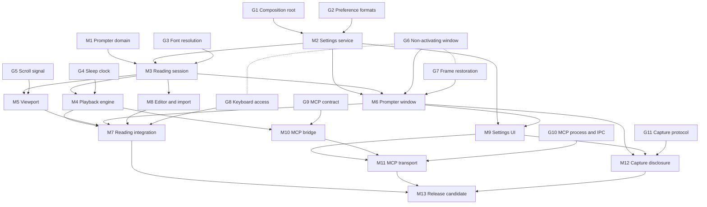

# Implementation plan

This plan sequences the MVP: PRD-01 to PRD-08 and the shared requirements in
PRD §10. PRD-09 and PRD §13 are excluded. The [PRD](PRD.md) defines behavior,
[Architecture](Architecture.md) defines ownership, and GitHub Issues hold task
scope and status. This plan does not restate requirements or track progress.

Facts cite their source. **Inference** marks a planning judgment that no
project document states.

## 1. Starting point

[Architecture §8.2](Architecture.md#82-current-snapshot) is the current-state
snapshot. It lists no shared owner, so no feature can run on real state until
M2 and M3 exist. Only items that change sequencing appear here.

- **Reused.** `LineLayoutEngine` and its test suite already cover most of
  F02.1 and F02.8. M1 adds only identity and revision stamping (F02.2), so
  Phase 1 starts at integration, not engine construction. The windowless
  unit-test host (`PromptlyMain`, `UnitTestHostTests`) lets every new owner be
  unit-tested from M1. The app target already sets
  `INFOPLIST_KEY_LSUIElement = YES` (project file, not listed in §8.2), so
  F05.6's no-Dock-icon rule needs verification, not work.
- **Replaced.** The composition root replaces `PromptlyApp`'s `@State` window
  model (M2, G1). `PromptlyAppDelegate` gains sleep forwarding (M4) and the
  quit check (M8). The window model, layout constants, window bridge,
  `PrompterView`, and `PrompterMenu` are reworked in M6 and M7, after G6 and
  G7. Their `NSApp.activate()` show path is a known deviation
  ([UI guide](AgentGuides/UIAndAccessibility.md#menu-bar-and-windows)). The
  bridge's `sharingType = .none` stays until G11 decides it.
- **Deleted.** `PrompterWindowState` and its tests, the prototype lock,
  collapse, and freeform-resize behavior, and the UI tests that exercise them go
  in M6. The layout demo goes in M5. **Inference:** the demo's last-good-layout,
  request-generation, and anchor logic is useful reference for M3, but it has no
  automated tests ([Line layout engine](LineLayoutEngine.md#validation-status)),
  so M3 rebuilds it under tests instead of moving it.

## 2. Decision gates

A gate closes before the milestone it gates starts. G1, G3–G7, G10, and part
of G9 are the open items in
[Architecture §10](Architecture.md#10-open-architectural-decisions). G2, G8,
and the rest of G9 are PRD gaps. G11 is the research that PRD-06 requires.

| Gate | Decision | Existing evidence | Gates | Kind |
|---|---|---|---|---|
| G1 | Composition root location, reachable from scenes and app-delegate callbacks | None; the prototype holds its only owner as scene `@State` | M2 | Decided inside the first owner task (Architecture §10) |
| G2 | Preference value formats and rules: font family, `System`, weights, fallback, text color (F08.2, F07.8) | Decided 2026-11-22 and recorded in F08.2; [Data and Privacy guide](AgentGuides/DataAndPrivacy.md#preferences) requires sign-off for later format changes | M2 | Product decision (closed) |
| G3 | Building the same `Font.Resolved` in the session as the rows render (F02.1, F02.3) | [Line layout engine](LineLayoutEngine.md#interface) documents `Font.Resolved.ctFont` and `Font(ctFont)` on macOS 26.0; render agreement is unvalidated | M3 | Research |
| G4 | `ContinuousClock` or `SuspendingClock` for playback when the sleep notification arrives late (F03.11) | None | M4 | Research |
| G5 | Native signal that separates user from programmatic scrolling (F03.7) | The demo uses `onScrollPhaseChange` (Architecture §4.5); physical input on macOS 26 is unvalidated | M5 | Research |
| G6 | Non-activating prompter: SwiftUI `Window` or an AppKit non-activating panel hosting SwiftUI (F05.6) | UI guide names the panel as likely; no spike | M6 | Research |
| G7 | Native restoration of the borderless prompter's frame, display validation, and discarding it on Restore All Defaults (F05.3, F05.7, F08.6); Promptly stores no coordinates (decided) | None. **Inference:** the G6 choice determines the restoration mechanism, so research G6 and G7 together | M6 | Research |
| G8 | Keyboard reachability of the in-window Play, Pause, and Rewind controls without taking focus from the frontmost app (§10.5, F05.6); the menu bar offers no playback commands (decided) | None; run with G6 | M7 | Research |
| G9 | MCP tool contract: source-range unit, error identifiers for the §10.4 cases, paging past the end, line-record fields, revision format (F07.2–F07.6) | [SDK evaluation](Research/MCPSwiftSDKEvaluation.md): validate arguments in the app, not through schema hints; the engine's ranges are UTF-16 | M10 | PRD clarification |
| G10 | MCP process layout, IPC, peer and same-user validation, packaging, SDK protocol version (F07.13, F07.16) | SDK evaluation prefers a client-launched Swift stdio helper with authenticated IPC, lists five spike checks, and flags the gap between SDK 0.12.1 and MCP revision 2026-07-28 | M11 | Research spike |
| G11 | Capture test protocol and the fate of `sharingType = .none` (F06.1) | [Compatibility matrix](Research/ScreenSharingCompatibility.md) has a template and no results | M12 | Research |

## 3. Milestones

The milestones refine [PRD §11](PRD.md#11-implementation-roadmap). The
settings service moves from Phase 3 to M2, ahead of the session, because the
session builds its layout configuration from settings (Architecture §2, §4.2).
The Settings UI stays late (M9). Phase 0 capture research becomes G11 and M12,
after the final window. **Inference:** visibility in captures can depend on the
window type and configuration that G6 changes.

A requirement listed in several milestones is split by layer; each exit
criterion names the part it closes. §10.2 is covered by the milestone that
builds each named service.

| ID | Milestone and goal | Requirements | Depends on | Gates |
|---|---|---|---|---|
| M1 | **Prompter domain:** revisions, stamped display lines, playback states, typed errors, duration and anchor-mapping policies | F02.1, F02.2, F02.6, F03.4, PRD-03 §3.2, §10.4 | — | — |
| M2 | **Settings service and composition root:** preference values, validation, partial updates, change records, persistence, protected keys, reset | F03.4, F05.1, F07.8, F07.10, F08.2, F08.3, F08.6–F08.9, §10.6 | — | G1, G2 |
| M3 | **Reading session core:** load and clear, latest-wins, layout configuration and reflow, phase gating, navigation with scroll tokens, visibility fact, failure recovery | F01.3–F01.5, F01.7, F02.4–F02.7, F02.9, F03.8, F04.1, F07.11, F08.9, §10.1, §10.3, §10.4 | M1, M2 | G3 |
| M4 | **Playback engine:** one scheduler, token-gated timers, pause, resume, rewind, completion, hide and sleep | PRD-03 §3.1–3.2, F03.1–F03.3, F03.5–F03.7, F03.9–F03.11, §10.3 | M3 | G4 |
| M5 | **Viewport:** rows from the committed layout, emphasis, focus position, scroll requests and reports, pending-layout display | PRD-03 §3.1, F02.3, F02.7, F02.8, F03.7, F04.2–F04.5 | M3 | G5 |
| M6 | **Prompter window:** non-activating window, presets, Attached and Floating placement, visibility reporting, displays and Spaces | F03.9, F05.1–F05.7, F08.6 | M2, M3 | G6, G7 |
| M7 | **Reading integration:** shell, in-window playback controls, menu-bar visibility, editor, placement, and Clear commands (no playback commands in the menu bar) | F01.5, F03.1, F03.7, F03.9, F05.4, F05.5, F08.3, §10.5 | M4, M5, M6, M8 | G8 |
| M8 | **Script editor and import:** draft model, bounded file reading, draft protection, quit check | F01.1, F01.2, F01.4, F01.6, F01.7 | M3 | — |
| M9 | **Settings UI:** four sections, MCP enablement disclosure, Restore All Defaults | F05.4, F07.15, F08.1–F08.6, §10.5 | M2, M6 | — |
| M10 | **MCP bridge (app side):** ten tools as typed requests, validation, enablement, agent origin, error mapping | PRD-07 §7.1, F01.7, F07.1–F07.12, F07.14, F07.15 | M4 | G9 |
| M11 | **MCP transport and clients:** helper or in-app stdio, secured IPC, connection lifecycle, status and setup UI, client validation | F07.13–F07.16, F08.4, F08.5 | M9, M10 | G10 |
| M12 | **Capture compatibility and disclosure:** recorded matrix, in-app and README disclosure | F06.1–F06.3, F08.5, §10.6 | M6, M9 | G11 |
| M13 | **Release candidate:** accessibility, performance, privacy audit, minimum OS, packaging | F01.4, F02.8, §10.5, §10.6, PRD §12 | M7, M11, M12 | — |

### Exit criteria

Every milestone passes `./Scripts/tests.sh build-and-test-unit` and the Swift
linters ([Testing and Validation](AgentGuides/TestingAndValidation.md)). M3,
M4, M10, and M11 also pass `test-tsan`. Layers follow
[Architecture §9](Architecture.md#9-validation-boundaries).

- **M1** (unit, table-driven): every line carries a unique identity and the
  supplied layout revision, and the existing engine suite still passes.
  Durations cover Unicode word counts, wrapped fragments, and blank lines;
  anchor mapping covers blank lines and the end of text. PRD-03 ACs on the
  0.6-second minimum and per-line timing.
- **M2** (unit, isolated defaults suite): atomic rejection, nested partial
  merge, last commit wins, agent-origin protected keys rejected, change records
  match Architecture §4.4, conditional revert keeps newer updates, reset
  disables MCP. One root builds the service; `UnitTestHostTests` still pass.
  PRD-08 ACs on defaults, persistence, atomicity, ordering, protected settings.
- **M3** (unit, injected layout function and presenter): latest load wins in
  any completion order, Clear invalidates pending loads, failed or oversized
  loads keep the session, gated commands return typed errors, reflow keeps the
  anchor. Scripts at the F01.7 boundary, including long grapheme clusters, set
  the engine limits by experiment. PRD-01 ACs on reset, ordering, and oversized
  input; PRD-02 ACs on position, stale results, failure recovery, and old
  revisions.
- **M4** (unit, injected clock): remaining time survives pause, timers start
  only on the current token, rapid commands never create a second scheduler,
  hide and sleep pause without catch-up, WPM applies from the next line, quit
  stops the scheduler. All PRD-03 ACs at session level.
- **M5** (UI tests and recorded manual evidence): rows match engine lines at
  each preset and font size, closing the render-agreement item in
  [Line layout engine](LineLayoutEngine.md#validation-status). Physical
  trackpad, mouse, and keyboard scrolling report as manual; programmatic
  scrolling does not. Reduce Motion is respected. All PRD-04 ACs; PRD-02 ACs
  on render agreement and recalculation display.
- **M6** (unit for pure placement geometry; replacement UI tests; recorded
  manual evidence): notch and no-notch, an external primary display, Spaces in
  an extended desktop, full-screen Spaces, display disconnection, and focus kept
  by the frontmost app. All PRD-05 ACs, with full-screen results documented.
- **M7** (UI journeys loading synthetic text through the editor; manual
  physical scrolling): PRD-03 ACs on hiding, reopening, Play while hidden, and
  manual scrolling end to end; PRD-05 ACs on presets and reopening. This meets
  the PRD §11 Phase 2 deliverable.
- **M8** (unit for the editor model and file reader with temporary files; UI
  journeys): `.txt` and `.md`, the 1,000,000-byte boundary, invalid UTF-8,
  cancelled discards, quit confirmation. All PRD-01 editor and import ACs.
- **M9** (UI tests; manual keyboard, VoiceOver, Light and Dark): PRD-08 ACs on
  layout, Settings not affecting playback, and Restore All Defaults.
- **M10** (unit for the bridge): enablement, draft exclusion, 100/200 paging
  without mixing revisions, stale revisions never remapped, layout-in-progress
  and window-hidden errors, disabling mid-request. PRD-07 ACs except client
  compatibility, transport, and the same-user boundary.
- **M11** (recorded client runs): tested Codex and Claude Desktop versions,
  wrong-user rejection, app-not-running error, no listening socket, bounded
  frames, idle CPU. The remaining PRD-07 ACs.
- **M12** (manual, per the research procedure): one matrix row per F06.1
  application and capture mode tested; disclosures match the rows. All PRD-06
  ACs.
- **M13**: evidence for each [PRD §12](PRD.md#12-mvp-acceptance-checklist)
  item, a macOS 26.0 run, a Release build, measured long-script performance,
  and README and Architecture §8.2 updated.

## 4. Parallelism

Parallel here means no shared owner type or files and no need for the other's
result. Consuming a finished owner's API, as M5 does with the session, is not
sharing. `App/` scene, menu, and lifecycle wiring is the one shared file area:
split each milestone's `App/` change into its own small task and land those in
sequence.

- **From the start:** M1 ∥ M2 (`Domain/Prompter` and the engine versus
  `Domain/Settings`, `Services/Preferences`, and `App/`). The file reader in M8
  (`Services/Files`) needs nothing and can run alongside. Research gates G3–G7,
  G10, and G11 touch no production source and can run any time before their
  milestones.
- **After M3:** M4 ∥ M5 ∥ M6 ∥ M8. M4 alone modifies the session; the others
  own `Viewport/`, `Windowing/`, and `ScriptEditor/`.
- **After M4:** M10 (`Services/MCP`) runs beside M5–M9.
- **After M6:** M9 ∥ M7 (`Features/Settings` versus the prompter shell and
  menu), and M12 testing, which is manual research, beside M10 and M11.
- **Not parallel:** M3 (every later milestone needs its API), M10 → M11, and
  G6, G7, and G8, which form one investigation.

**Inference:** the critical path is G2 → M2 → M3 → M6 → M7 → M13, with G6 and
G7 due before M3 finishes. MCP (M10 → M11 after G10) is the second-longest
chain.

## 5. Dependency graph

Dotted links mark G6, G7, and G8 as one joint investigation.

## 6. First batch candidates

IDs follow
[`task-batch.schema.json`](../.agents/schemas/task-batch.schema.json).

| ID | Title | Type, area | Requirements | Depends on | Why first |
|---|---|---|---|---|---|
| LAYOUT-001 | Stamp display lines with identity and layout revision | Implementation, Layout | F02.2, F02.5 | — | The smallest change to reused code; the session, viewport, and MCP line records all need it (M1). Testable through the existing engine suite. |
| LAYOUT-002 | Decide how the session resolves fonts outside a view | Research, Layout | F02.1, F02.3 | — | Closes G3 on the critical path to M3; existing engine notes answer half. Verifiable with a unit test comparing the session's resolved font with the row font across weights and sizes. |
| SETTINGS-001 | Decide preference value formats | Research, Settings | F07.7, F08.2 | — | Closes G2, the only open blocker for M2. Stored formats affect persistence compatibility, so they need sign-off before code. Decided on 2026-11-22 (F08.2); no issue needed. |
| SETTINGS-002 | Add the settings service and composition root | Implementation, Settings | F07.10, F08.7–F08.9 | SETTINGS-001 | Settles G1 and unblocks the session, window, Settings UI, and MCP. Fully unit-testable with an isolated defaults suite. |
| WINDOW-001 | Research a non-activating prompter, native frame restoration, and keyboard reachability | Research, Window | F05.3, F05.6, F05.7, F08.6, §10.5 | — | Closes G6, G7, and G8, the longest-lead unknowns before M6 and M7. Needs physical displays and recorded evidence, so it should start now. |

## 7. Open questions

### Resolved on 2026-11-22

- **Window coordinates.** The PRD is right: Promptly stores no window
  coordinates (F05.3, F08.7). [AGENTS.md §6](../AGENTS.md#6-privacy-and-security)
  and the [README](../README.md#privacy) now say so too. **Inference:** if G6
  picks an AppKit panel, frame autosave writes the frame to the app's defaults
  domain; G7 must establish whether that counts as native restoration.
- **README status.** Architecture §8.2 is right: `PrompterWindowState` is unused
  and never persisted. The README no longer lists window-placement preferences.
- **Preference formats (G2).** F08.2 now records the decisions: a font is
  identified by family name; `System` means the current macOS system font;
  every installed family is selectable; only the weights a family provides are
  offered and accepted, and a missing weight becomes the closest available one,
  lighter on a tie; an uninstalled family falls back to `System` at the same
  weight; colors are `#RRGGBB` in either case, stored uppercase, without alpha
  or a contrast minimum. **Inference:** "weights" means the four F08.2 weights,
  so the MCP `font_weight` values stay unchanged.
- **Keyboard access.** The menu bar offers no Play, Pause, or Rewind, so the
  in-window controls are the only keyboard route. G8 is now research, run with
  G6: can those controls be reached by keyboard, including Full Keyboard Access
  and VoiceOver, without taking focus from the frontmost app? If not, §10.5 and
  F05.6 conflict and need a product decision.
- **Engine limits.** Decided by experiment during M3 testing. The engine's
  default 1,000,000 UTF-16-unit limit
  ([Line layout engine](LineLayoutEngine.md#source-and-failure-behavior)) can
  reject a script within F01.7's 100,000 user-perceived characters, because one
  cluster can span many units; a family emoji is 11.

### Open

- **Ambiguity, MCP contract (G9).** PRD-07 names no source-range unit, no error
  identifiers, no behavior when `start_index` is at or past the line count
  (including an empty session), and no line-record fields beyond ranges. A
  suggested contract is under review.
- **Assumption, commands during recalculation.** F07.11 rejects Play and
  navigation, including Rewind. The plan assumes Pause stays an idempotent
  success and that loads and settings updates remain accepted, latest wins.
- **Assumption, capture disclosure.** F06.3's in-app disclosure lives in
  About's privacy information (F08.5), separate from the MCP disclosure.
- **Assumption, integration status.** F08.4's status depends on whether the app
  can observe client connections (G10). Until M11, M9 shows only enabled or
  disabled.
- **Assumption, test loading path.** M7 loads synthetic text through the editor
  (M8), so no test-only script injection is added.
