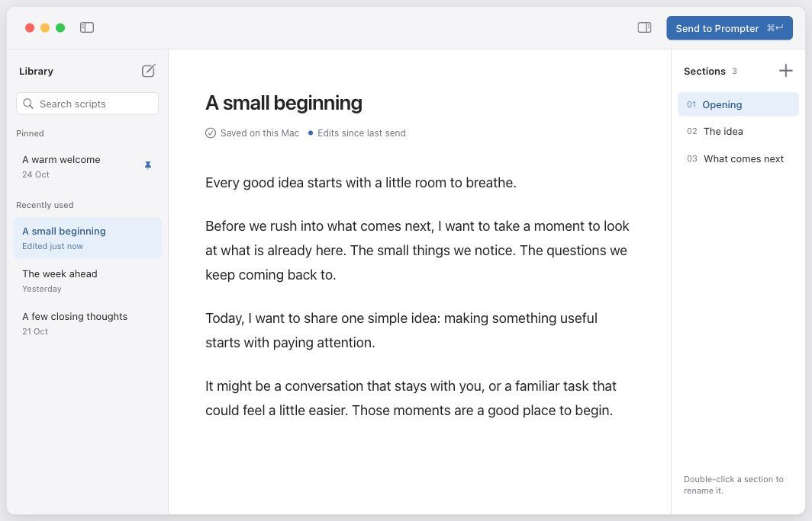
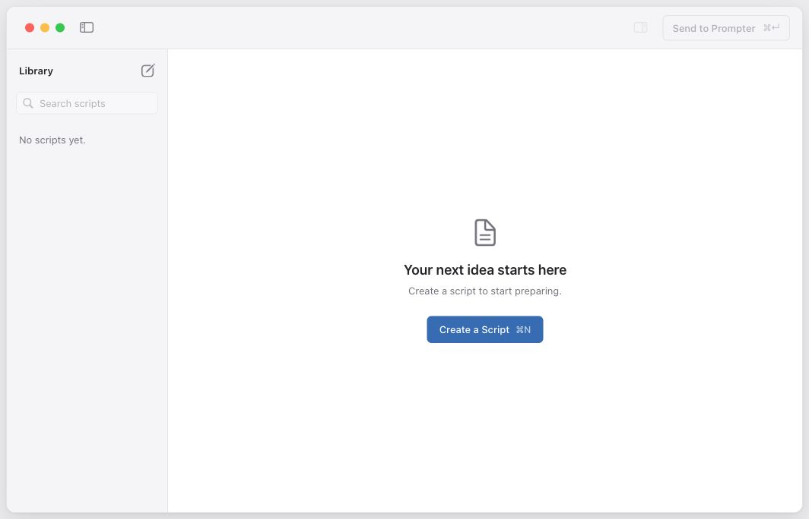
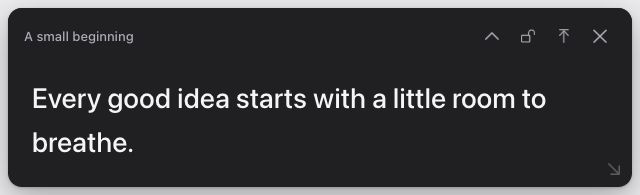
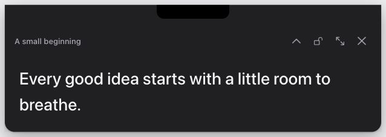

# Approved Quiet Native design

**Status:** Approved by the user on **2026-10-31**, including the final reader
control-size refinement. Quiet Native is the current visual baseline for the
Library and reader. Native adoption and validation remain pending.

The [Library interaction contract](LibraryDesign.md), README product contracts,
and roadmap still govern behavior, privacy, persistence and recovery. Approval
does not authorize app implementation or complete a roadmap milestone.

## Approved versions

The [Superdesign project](https://superdesign.dev/teams/4a28d3f6-da15-4afc-ad86-e77eeed9ee61/projects/89aaf78f-5df9-4564-839f-711f4a8e486a)
remains editable. These are the approved draft versions; the dated local images
freeze their visual state independently of later canvas or component changes.

| State | Superdesign draft | Draft version | ReaderHeader component version |
| --- | --- | --- | --- |
| Overview | [Quiet Native Exploration](https://p.superdesign.dev/draft/50c18ac7-db29-4798-9721-a06a6db6fa21) | 4 | 3 |
| Library active | [Library · Active](https://p.superdesign.dev/draft/816df858-be9b-4fa8-be18-4d180e9b5048) | 2 | — |
| Library empty | [Library · Empty](https://p.superdesign.dev/draft/a17a8156-0dac-4e52-b385-c41330f73296) | 2 | — |
| Reader detached | [Reader · Detached](https://p.superdesign.dev/draft/7df8b1dc-2d2e-449b-9b1c-2f376b7b4e2a) | 2 | 3 |
| Reader anchored | [Reader · Anchored](https://p.superdesign.dev/draft/ffc5bbcf-d78a-418b-8cff-a665c1699f44) | 2 | 3 |

The shared ReaderHeader is `93e127ef-46a5-4991-93d2-dc3557611848`.
Its version matters separately from the draft version: the last refinement
changed its glyphs from 16 to 14 without changing the containing draft IDs.
The [snapshot manifest](Design/QuietNative/2026-10-31/Approval.json) records
versions and image hashes. The [overview](Design/QuietNative/2026-10-31/Overview.jpg)
contains review labels outside the product windows; those labels are not app UI.

## Library

- Retain the sidebar/editor/Sections layout, quiet toolbar, one Send action,
  honest title-level save status and approved empty-state hierarchy.
- Use system typography and proportional system digits for section order numbers.
  Do not introduce a code-style or monospaced font for those numbers.
- Use `pin.fill` for the pinned-row indicator, tinted with the shared accent.
  The depicted accent is blue (`#356CB6`); a future accent preference should
  also change the pin tint. This approval does not implement that setting.
- Use SF Symbols for toolbar, row, contextual and swipe actions. Duplicate uses
  `doc.on.doc`, Delete uses `trash`, Pin uses `pin.fill`, and Unpin uses
  `pin.slash`. Keep Duplicate neutral, Delete red and Pin/Unpin accent-colored.
- Keep the tighter row/paragraph rhythm, white bordered search field and lighter
  selection fills. Rename guidance sits at the inspector's bottom.
- Omit the earlier active sidebar's disk/On this Mac/script-count footer.
  Local-storage and save-state communication remains near the document title.

## Reader

- Use the quiet script-title header, charcoal reading surface, softened white
  text, modest corners and shared system typography. Keep large reading text.
  Omit the prominent Promptly title and uppercase SAMPLE SCRIPT label.
- Use native SF Symbols: `chevron.up`/`chevron.down`, `lock.open`/`lock.fill`,
  `arrow.up.left.and.arrow.down.right` for Detach, `arrow.up.to.line` for Return
  to Notch, and `xmark` for Hide. The browser reference uses regular-weight
  14 px glyphs inside 32 px targets; preserve the smaller visual size without
  shrinking accessible targets during native adoption.
- The decorative `arrow.down.right` resize cue is 12 px, with equal 12 px
  trailing and bottom insets measured from its visible bounds.
- Keep anchored top corners square and controls below the notch-safe region.
  Use actual display geometry in the native app, not the mockup's fixed notch.

## Adoption boundaries

These are synthetic browser visuals. The browser embeds static renders exported
from AppKit SF Symbols; native code should use the named symbols to support
native rendering and future symbol effects. Browser assets or CDN dependencies
must not become runtime dependencies of the offline Mac app.

The depicted charcoal reader is a visual default. Planned Light, Dark, system
appearance and accessibility support remain required. Preserve existing native
dragging, resizing, collapse, locking, focus and display behavior when adopting
the styling. Native keyboard, VoiceOver, reduced effects, notch and capture
compatibility still require their documented validation.

The short sample does not authorize truncating a script, shrinking text during
resize, or abandoning scrolling and logical reading-position requirements.
No playback, script storage, handoff, privacy permission or recovery behavior
is implemented or changed by this approval.

## Earlier references

The earlier [Native active v6](Design/Library/Active-v6.png) and
[empty v7](Design/Library/EmptyLibrary-v7.png) images remain unchanged for history.
Quiet Native supersedes their visual styling; the Library's existing interaction
and 10-second Undo/recovery contracts remain in force.
